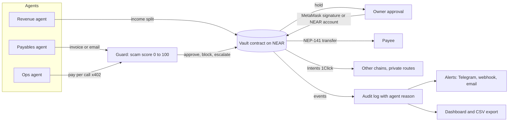

# AgentGuard

**A NEAR vault where AI agents run a small business's money, and can only act inside the owner's rules.**

Every payment passes a guard. Anything over a limit waits for a human. Every action is logged on chain with the agent's reason.

Built for the NEAR Hackathon 2026. Tracks: AI Security and Defense, Agent Economy, Autonomous Business, Real World Money.
Also fits: AI Swarms (three agents, one vault) and Privacy (privacy shield, private payouts, privacy audit).

Live on NEAR testnet: vault `agentguard.prasanna-ag.testnet`

## Run it in two minutes (no keys needed)

```bash
cd web
npm install
npm run dev          # open http://localhost:3000
```

Click **Demo** in the top bar. You get a full vault with agents, approvals and the guard, all in memory.
Nothing else to set up. Click **NEAR testnet** to read the live vault on chain.

```bash
npm test             # 58 tests
cd ../contract && cargo test   # 35 tests, runs natively
```

## How it works



A payment moves like this:

1. An agent asks the vault to pay. It must be a registered agent with a limit for that token.
2. The vault checks the rules: token list, per payment limit, daily cap, known payee, pause switches.
3. The guard account scores the payee and sends a verdict: approve, block or escalate.
4. Escalated payments wait for the owner. Large ones can need two approvers.
5. The vault sends the token. A failed transfer gives the budget back.
6. Every step is an on chain event with the agent's reason.

## The three agents

| Agent | Job | Limits it cannot cross |
| --- | --- | --- |
| Payables | Reads invoices and emails and pays them. Other chains go through NEAR Intents | Per payment limit, daily cap, new payee hold |
| Ops | Buys APIs one call at a time. The server answers 402, the vault pays, the agent retries with the receipt | 0.50 USDC per call, 20 USDC per day |
| Revenue | Splits income by the owner's percent rules | It cannot pick who gets paid |

Agents never hold the money. The vault sends it.

## Safety features

- **Guard**: plain readable rules. Invalid address, scam list, new wallet, lookalike payee, pressure words, odd amount, first payment. 70 and over blocks. 35 to 69 goes to the owner.
- **Auto pause**: an agent stopped or dismissed three times in a row is paused before it tries again. The count is set by the owner.
- **Two person approval**: payments above an amount need the owner and one co-approver. A co-approver can approve or dismiss and never change rules.
- **Private payouts**: mark a payee private and the payout routes through NEAR Intents confidential settlement (mainnet).
- **Owner signing**: MetaMask `personal_sign` checked on chain with `ecrecover`. A relayer only pays gas and cannot forge an approval. Each signature names the vault, a nonce and the exact action, so it cannot be replayed.
- **Alerts**: Telegram, a Slack or Discord webhook, or email when a payment waits, is blocked or an agent is paused.
- **Invoice by email**: forward an invoice to your inbound address. Payables reads it. Every rule still applies.
- **CSV export** of the full activity log for the accountant.

## Privacy

Everything an agent does is public on chain. AgentGuard treats that record as something to protect.

- **Privacy shield**: emails, phone numbers, IBANs, card numbers and account numbers in an invoice are masked before the agent writes its reason or memo on chain.
- **Private payouts**: a payee marked private is paid through NEAR Intents confidential settlement, so the link between you and them is not public.
- **Privacy audit** (`/app/privacy`): built on the method of [Cloudflare's security audit skill](https://github.com/cloudflare/security-audit-skill), scaled to one vault.
  1. Recon maps every public surface (each reason, memo, payee history, split rule, co-approver list) into a coverage ledger.
  2. Isolated hunters check only their own units: personal data, sensitive purpose, linkability, private route, business map, and an optional model reviewer.
  3. A separate verifier re-reads the raw record and tries to disprove each candidate. Model leads must quote exact text, and a second model pass tries to reject them.
  4. Each record is confirmed (full trace and severity), needs validation (one open fact, no severity) or rejected (disproved, or a hardening note another layer covers).
  5. The report, findings JSON and a privacy score come only from verified records. One click on a finding marks the payee private.

## What was tested live on testnet

- Vault upgraded in place with state kept (migrate) and funds intact.
- Payables paid 2,000 USDC to a trusted payee. A new payee held 840 USDC for owner approval, then paid. A lookalike payee (900 USDC) was dismissed.
- Revenue split 900 USDC into 630 and 270 by the owner's rules.
- Ops paid 0.003 USDC per call to a paid API on chain. Its spend counter moved against its 20 USDC cap.
- Over limit request (1,200 USDC against a 1,000 limit) was refused by the vault.
- Auto pause: the guard blocked three bad invoices in a row (a lookalike payee, then a payee on the scam list) and the vault paused the Payables agent by itself.

## Folders

| Folder | What it is |
| --- | --- |
| `contract/` | Rust vault (near-sdk 5). Limits, allowlists, approvals, guard verdicts, splits, auto pause, two person approval, events |
| `token/` | Test USDC (NEP-141) so anyone can fund a testnet vault for free |
| `web/` | Next.js 16 app: landing page, dashboard, agents, approvals, rules, activity, API routes |
| `scripts/` | PowerShell deploy, token and upgrade scripts |
| `ci/` | Contract CI workflow |

## Telegram alerts

```powershell
# Make a bot with @BotFather, send it hi, then:
powershell -ExecutionPolicy Bypass -File scripts\setup-telegram.ps1 -Token "123456:ABC..."
```

## Run it on your own testnet vault

Needs Rust, `cargo-near`, the `near` CLI and a funded testnet account.

```powershell
powershell -ExecutionPolicy Bypass -File scripts\deploy-testnet.ps1   # vault, guard and agents
powershell -ExecutionPolicy Bypass -File scripts\make-token.ps1       # test USDC, funds the vault
powershell -ExecutionPolicy Bypass -File scripts\make-env.ps1         # writes web\.env
powershell -ExecutionPolicy Bypass -File scripts\upgrade-vault.ps1    # new contract code and the Ops agent
```

## Settings (`web/.env`, all optional)

| Variable | What it turns on |
| --- | --- |
| `NEXT_PUBLIC_NEAR_NETWORK`, `NEAR_VAULT_ID`, `NEAR_GUARD_ID`, `NEAR_GUARD_KEY` | Live vault on NEAR (testnet by default) |
| `NEAR_PAYABLES_ID/KEY`, `NEAR_REVENUE_ID/KEY`, `NEAR_OPS_ID/KEY`, `NEAR_OPS_PAY_TO` | Agent accounts that sign on chain |
| `NEAR_RELAYER_ID`, `NEAR_RELAYER_KEY` | Pays gas for MetaMask owner actions |
| `INTENTS_JWT` | Real NEAR Intents quotes for other chains |
| `OPENAI_API_KEY`, `OPENAI_MODEL` | OpenAI for agent reasons and the privacy audit model reviewer |
| `NEAR_AI_API_KEY` | NEAR AI wording for the agent reasons |
| `TELEGRAM_BOT_TOKEN`, `TELEGRAM_CHAT_ID`, `ALERT_WEBHOOK_URL`, `RESEND_API_KEY`, `ALERT_EMAIL_TO`, `ALERT_EMAIL_FROM` | Alerts |
| `INBOUND_EMAIL_SECRET`, `INBOUND_EMAIL_FROM` | Invoice by email (`POST /api/inbound/email?key=...`) |

Never commit `web/.env`. Without keys every feature falls back to a clearly marked demo behavior.

## Honest limits

- Testnet only. Cross chain and private routes need mainnet tokens, so Pay on Base and Pay privately do not settle on testnet.
- Payee intelligence is demo data in `web/src/lib/server/intel.ts`. A real deployment needs an indexer lookup and a maintained scam list.
- Two person approval, alerts and email intake are covered by unit tests. They need a second signer or service keys to run live.
- The guard is a simple scored rule set, not a model. It is meant to be read and audited.

## License

MIT
