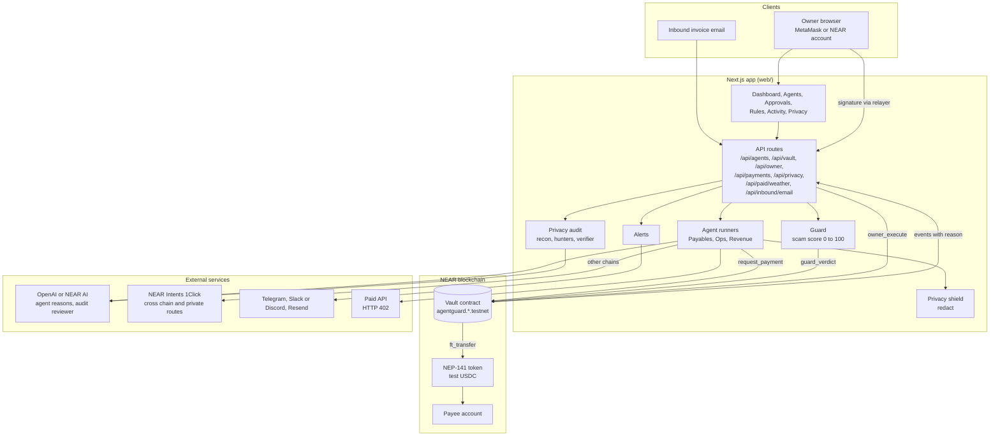
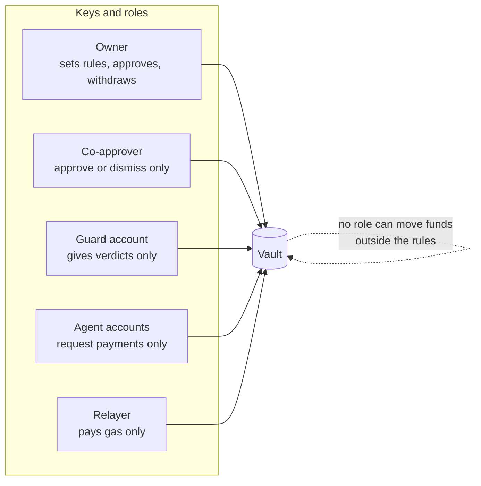
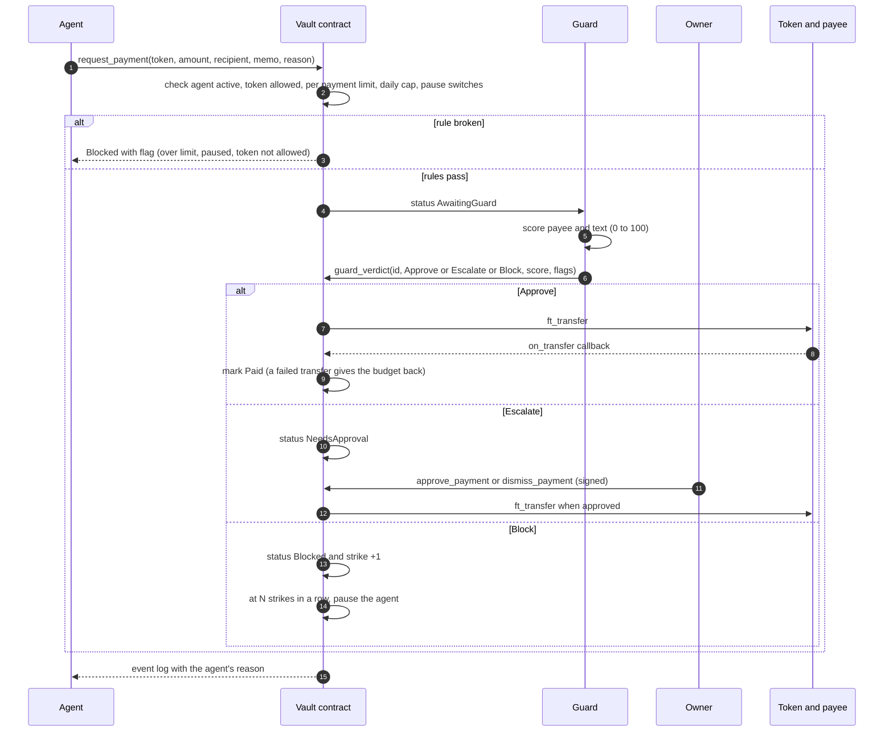
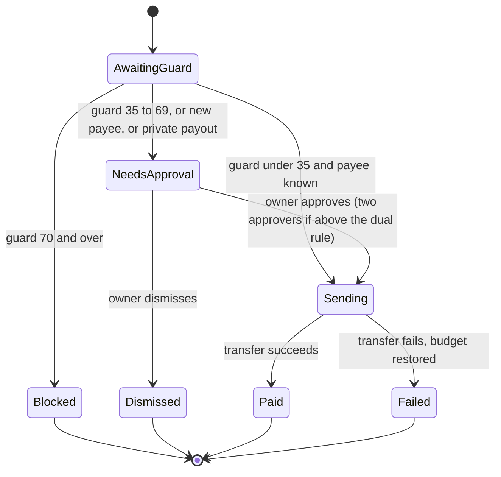
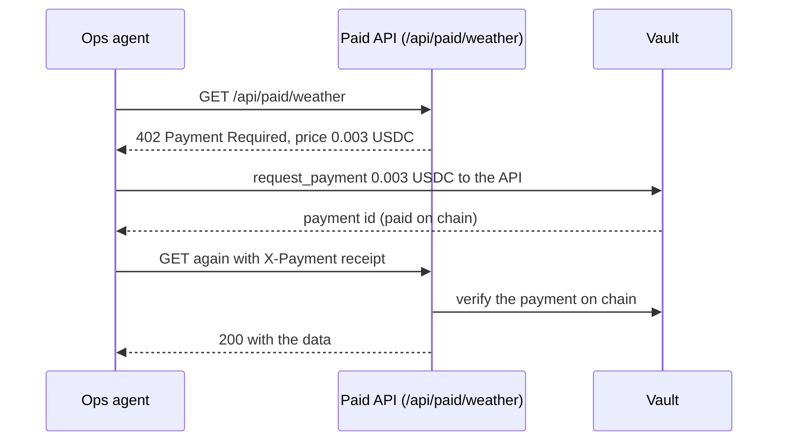
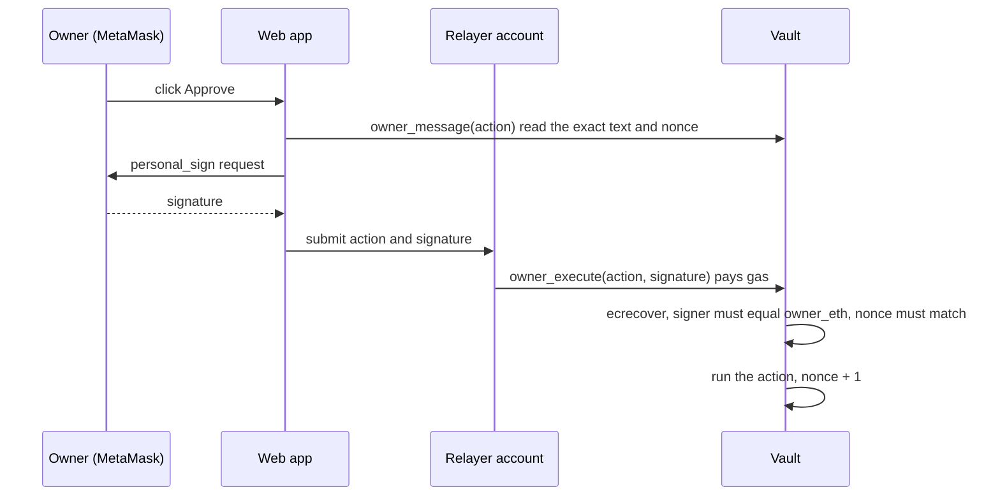

# AgentGuard

**Give AI your money. Not the keys.**

AgentGuard is a NEAR smart contract vault where AI agents run a small business's money, and can only act inside the owner's rules. Every payment passes a guard. Anything over a limit or to a new payee waits for a human. Every action is logged on chain with the agent's own reason.

Built for the NEAR Hackathon 2026.
Tracks: AI Security and Defense, Agent Economy, Autonomous Business, Real World Money, Privacy, AI Swarms.

| | |
| --- | --- |
| Live vault (NEAR testnet) | [`agentguard.prasanna-ag.testnet`](https://testnet.nearblocks.io/address/agentguard.prasanna-ag.testnet) |
| Stack | Rust (near-sdk 5), Next.js 16, React 19, TypeScript, viem |
| Tests | 35 contract tests, 59 app tests |
| License | MIT |

## Contents

1. [The problem](#the-problem)
2. [Run it in two minutes](#run-it-in-two-minutes-no-keys-needed)
3. [Architecture](#architecture)
4. [The payment lifecycle](#the-payment-lifecycle)
5. [The three agents](#the-three-agents)
6. [The guard](#the-guard)
7. [Owner signing](#owner-signing)
8. [Privacy](#privacy)
9. [Integrations](#integrations)
10. [Contract reference](#contract-reference)
11. [HTTP API reference](#http-api-reference)
12. [Security model](#security-model)
13. [What was tested live on testnet](#what-was-tested-live-on-testnet)
14. [Repository layout](#repository-layout)
15. [Deploy your own](#deploy-your-own)
16. [Configuration](#configuration)
17. [Testing and CI](#testing-and-ci)
18. [Honest limits](#honest-limits)

## The problem

AI agents can now earn and spend money. A small business cannot hand one a bank card: one bad invoice, one prompt injection or one lookalike payee and the money is gone.

AgentGuard moves the trust boundary. The money sits in a contract the agent cannot drain. The agent can only ask. The contract enforces the owner's rules on chain, a separate guard scores every payment, and a human decides the risky ones.

## Run it in two minutes (no keys needed)

```bash
cd web
npm install
npm run dev          # open http://localhost:3000
```

Click **Demo** in the top bar. You get a full vault with agents, approvals and the guard, all in memory. Click **NEAR testnet** to read the live vault on chain.

```bash
npm test                          # 59 app tests
cd ../contract && cargo test      # 35 contract tests, runs natively
```

## Architecture

### System view



### Who can do what



No role other than the owner can change a rule. No role can move money except through a payment the vault has cleared.

## The payment lifecycle



### Payment states



## The three agents

Each agent is a separate NEAR account with its own limits per token. They share one vault. This is the AI Swarms pattern: three roles, one treasury, no shared keys.

| Agent | Job | Limits it cannot cross |
| --- | --- | --- |
| **Payables** | Reads invoices and emails, extracts payee and amount, pays. Other chains go through NEAR Intents | Per payment limit, daily cap, new payee hold, guard verdict |
| **Ops** | Buys APIs and data one call at a time with HTTP 402 (x402 style) | 0.50 USDC per call, 20 USDC per day |
| **Revenue** | Splits incoming income by the owner's percent rules | It cannot choose who gets paid |

Agents never hold the funds. The vault sends them.

### Ops: pay per call



### Revenue: split by rule

`distribute_revenue(token, amount, reason)` splits an amount across the owner's `SplitRule` list in basis points (for example 70 percent and 30 percent). The agent supplies only the amount. The recipients and shares are fixed by the owner.

## The guard

The guard is a plain scored rule set the owner can read and audit. It is not a model, so it cannot be talked out of a rule. Each rule adds points and a flag that says why.

| Rule | Points |
| --- | --- |
| Address is not valid for its chain | 70 |
| Address is on a public scam list | 100 |
| Wallet is under 2 days old | 55 |
| Wallet is under 14 days old | 30 |
| Looks like a trusted payee (edit distance 2 or less) | 60 |
| Pressure words in memo or reason (urgent, gift card, changed account, ceo asked, and more) | 20 each, up to 40 |
| Amount is 10 times your usual payment | 35 |
| Amount is 4 times your usual payment | 20 |
| First payment to this payee | 8 |

Score 70 and over: **Block**. 35 to 69: **Escalate** to the owner. Under 35: **Approve**.

Source: `web/src/lib/guard/scam.ts`, with tests in `scam.test.ts`.

## Owner signing

The owner approves from MetaMask. Nobody needs a NEAR wallet or gas.



The signed text names the vault, the nonce and the exact action. A signature cannot be replayed on another vault, replayed twice, or reused for a different action. The relayer pays gas and cannot forge an approval.

A **co-approver** (an Ethereum address the owner adds) can only approve or dismiss. It can never change a rule.

## Privacy

Everything an agent does is public on chain. AgentGuard treats that record as something to protect.

```mermaid
flowchart LR
  INV["Invoice text<br/>email, phone, IBAN, card"] --> SH["Privacy shield<br/>mask before chain write"]
  SH --> CH["On chain memo and reason"]
  CH --> AUD["Privacy audit"]
  AUD --> REC["1. Recon<br/>coverage ledger"]
  REC --> HUN["2. Hunters<br/>isolated units"]
  HUN --> VER["3. Verifier<br/>tries to disprove"]
  VER --> OUT["4. Confirmed,<br/>needs validation,<br/>rejected"]
  OUT --> REP["5. Report and score<br/>from verified records only"]
  REP -->|"one click"| PRV["Mark payee private"]
```



- **Privacy shield** (`web/src/lib/privacy/redact.ts`): emails, phone numbers, IBANs, card numbers (Luhn checked) and account numbers are masked before the agent writes its reason or memo on chain.
- **Private payouts**: a payee marked private is paid through NEAR Intents confidential settlement, so the link between you and them is not public (mainnet).
- **Privacy audit** (`/app/privacy`): built on the method of [Cloudflare's security audit skill](https://github.com/cloudflare/security-audit-skill), scaled to one vault.
  1. **Recon** maps every public surface (each reason, memo, payee history, split rule, co-approver list) into a coverage ledger.
  2. **Hunters** check only their own units: personal data, sensitive purpose, linkability, private route, business map, and an optional model reviewer.
  3. A separate **verifier** re-reads the raw record and tries to disprove each candidate. Model leads must quote exact text, and a second model pass tries to reject them.
  4. Each record ends **confirmed** (full trace and severity), **needs validation** (one open fact, no severity) or **rejected**.
  5. The report, findings JSON and a privacy score come only from verified records.

## Integrations

| Integration | What it does here | Where | Needs |
| --- | --- | --- | --- |
| **NEAR Protocol** | Vault contract, agent accounts, guard account, owner actions, events | `contract/`, `web/src/lib/near/` | Testnet account and keys for live mode |
| **NEP-141 tokens** | Holds and sends USDC. `ft_on_transfer` funds the vault | `token/`, `contract/src/lib.rs` | Test USDC from `scripts/make-token.ps1` |
| **NEAR Intents (1Click)** | Cross chain payouts and private routes | `web/src/lib/agents/intents.ts` | `INTENTS_JWT`, mainnet tokens |
| **MetaMask** | Owner and co-approver signing with `personal_sign` | `web/src/lib/wallet/metamask.ts`, `web/src/lib/owner/actions.ts` | A browser wallet |
| **x402 style pay per call** | HTTP 402, pay through the vault, retry with receipt | `web/src/app/api/paid/weather/`, `web/src/lib/agents/ops.ts` | None (demo API included) |
| **OpenAI** | Agent reasons and the privacy audit model reviewer | `web/src/lib/agents/llm.ts` | `OPENAI_API_KEY`, `OPENAI_MODEL` |
| **NEAR AI** | Fallback wording for agent reasons | `web/src/lib/agents/llm.ts` | `NEAR_AI_API_KEY` |
| **Telegram, Slack or Discord webhook, Resend email** | Alerts when a payment waits, is blocked or an agent is paused | `web/src/lib/server/alerts.ts` | Bot token, webhook or email key |
| **Inbound email** | Forward an invoice to Payables | `web/src/app/api/inbound/email/` | `INBOUND_EMAIL_SECRET` |
| **CSV export** | Full activity log for the accountant | `web/src/lib/csv.ts` | None |
| **GitHub Actions** | Builds and tests the contract in the cloud | `.github/workflows/contract.yml` | None |

Every integration falls back to a clearly marked demo behavior when its key is missing, so the project always runs.

## Contract reference

Rust, near-sdk 5. Source: `contract/src/lib.rs`. State migrates in place with `migrate()` so funds and history survive upgrades.

**Owner methods** (the owner account, or a valid owner signature through `owner_execute`)

| Method | Purpose |
| --- | --- |
| `add_agent`, `remove_agent` | Register or drop an agent account |
| `set_agent_limits` | Per token daily cap and per payment limit |
| `set_agent_paused`, `set_paused` | Pause one agent or the whole vault |
| `set_new_payee_needs_approval` | Hold first time payees for approval |
| `add_known_payee`, `remove_known_payee` | Trusted payee list |
| `set_payee_private` | Route a payee through private settlement |
| `set_splits` | Revenue split rules in basis points |
| `set_co_approvers`, `set_dual_rules` | Two person approval above an amount |
| `set_auto_pause_after` | Strikes in a row before an agent is paused |
| `approve_payment`, `dismiss_payment` | Decide a held payment |
| `withdraw`, `set_guard`, `set_owner_eth` | Funds and key management |

**Agent and guard methods**

| Method | Caller | Purpose |
| --- | --- | --- |
| `request_payment` | Agent | Ask the vault to pay |
| `distribute_revenue` | Revenue agent | Split an amount by the owner's rules |
| `guard_verdict` | Guard account | Approve, escalate or block with score and flags |
| `deposit`, `ft_on_transfer` | Anyone | Fund the vault |
| `owner_message`, `owner_execute` | Anyone (relayer) | Signed owner actions checked with `ecrecover` |

**Views**: `get_config`, `get_agents`, `get_security`, `get_payment`, `get_payments`, `get_payments_count`, `get_pending_approvals`, `get_approvals`, `get_known_payees`, `get_splits`.

Every state change emits an event that carries the agent's reason.

## HTTP API reference

| Route | Method | Purpose |
| --- | --- | --- |
| `/api/vault` | GET | Vault config, agents, payments (demo or chain) |
| `/api/agents/[kind]` | POST | Run Payables, Ops or Revenue |
| `/api/payments/[id]` | POST | Approve or dismiss a held payment |
| `/api/owner` | POST | Relay a signed owner action |
| `/api/owner/claim` | POST | Claim the demo vault as owner |
| `/api/privacy` | POST | Run the privacy audit `{network, vault, useModel}` |
| `/api/paid/weather` | GET | Example paid API that answers 402 |
| `/api/inbound/email` | POST | Invoice by email (`?key=...`) |
| `/api/alerts` | POST | Send or test an alert |
| `/api/reset` | POST | Reset the demo vault |

## Security model

| Threat | Defense |
| --- | --- |
| Agent tries to drain the vault | The agent holds no funds. Per payment limit and daily cap are enforced on chain |
| Prompt injection inside an invoice | The agent can only call `request_payment`. The vault and guard still apply every rule |
| Lookalike or scam payee | Guard flags it and the vault holds or blocks it |
| An agent keeps trying | Auto pause after N stopped payments in a row |
| Rogue or compromised agent key | The owner pauses or removes it. Limits cap the loss |
| Relayer abuse | The relayer only pays gas. Owner actions need a valid signature |
| Signature replay | Signed text names the vault, nonce and exact action |
| One approver compromised | Two person approval above a set amount. Co-approvers cannot change rules |
| Private data on a public chain | Privacy shield, private payouts and the privacy audit |
| Leaked secrets | Keys only in env vars. `web/.env` is never committed |

The contract validates sizes (text, ids, limit and split counts) and uses a callback so a failed transfer restores the budget.

## What was tested live on testnet

Vault: `agentguard.prasanna-ag.testnet`.

- Vault upgraded in place with state kept (`migrate`) and funds intact.
- Payables paid 2,000 USDC to a trusted payee. A new payee held 840 USDC for owner approval, then paid. A lookalike payee (900 USDC) was dismissed.
- Revenue split 900 USDC into 630 and 270 by the owner's rules.
- Ops paid 0.003 USDC per call to a paid API on chain. Its spend counter moved against its 20 USDC cap.
- An over limit request (1,200 USDC against a 1,000 limit) was refused by the vault.
- Auto pause: the guard blocked three bad invoices in a row (a lookalike payee, then a payee on the scam list) and the vault paused the Payables agent by itself. The owner resumed it with `set_agent_paused`.
- Owner approval with a MetaMask signature, checked on chain with `ecrecover`.

## Repository layout

```text
contract/                Rust vault (near-sdk 5)
  src/lib.rs               limits, allowlists, approvals, guard verdicts, splits,
                           auto pause, two person approval, owner_execute, events
token/                   Test USDC (NEP-141) so anyone can fund a testnet vault
web/                     Next.js 16 app
  src/app/                 landing page, /app dashboard, agents, approvals, rules,
                           activity, privacy, and /api routes
  src/lib/vault/           in memory engine that mirrors the contract (demo mode)
  src/lib/guard/           scam score rules
  src/lib/agents/          Payables, Ops, Revenue, invoice parser, Intents, LLM client
  src/lib/near/            RPC, chain calls, network config
  src/lib/owner/           signed owner action builders
  src/lib/wallet/          MetaMask
  src/lib/privacy/         redact (shield) and audit
  src/lib/server/          pipeline, alerts, inbound email, store, verification
scripts/                 PowerShell and shell deploy, token, env and upgrade scripts
docs/submission.md       Hackathon submission text
.github/workflows/       Contract build and test in the cloud
```

The demo engine in `web/src/lib/vault/engine.ts` follows the same rules as the contract, so demo mode behaves like the real vault.

## Deploy your own

Needs Rust, `cargo-near`, the `near` CLI and a funded testnet account.

```powershell
powershell -ExecutionPolicy Bypass -File scripts\deploy-testnet.ps1   # vault, guard and agents
powershell -ExecutionPolicy Bypass -File scripts\make-token.ps1       # test USDC, funds the vault
powershell -ExecutionPolicy Bypass -File scripts\make-env.ps1         # writes web\.env
powershell -ExecutionPolicy Bypass -File scripts\upgrade-vault.ps1    # new contract code and the Ops agent
```

Telegram alerts (optional):

```powershell
# Make a bot with @BotFather, send it hi, then:
powershell -ExecutionPolicy Bypass -File scripts\setup-telegram.ps1 -Token "123456:ABC..."
```

## Configuration

All settings live in `web/.env` and all are optional. Copy `web/.env.example`.

| Variable | What it turns on |
| --- | --- |
| `NEXT_PUBLIC_NEAR_NETWORK`, `NEAR_VAULT_ID`, `NEAR_GUARD_ID`, `NEAR_GUARD_KEY` | Live vault on NEAR (testnet by default) |
| `NEAR_PAYABLES_ID/KEY`, `NEAR_REVENUE_ID/KEY`, `NEAR_OPS_ID/KEY`, `NEAR_OPS_PAY_TO` | Agent accounts that sign on chain |
| `NEAR_RELAYER_ID`, `NEAR_RELAYER_KEY` | Pays gas for MetaMask owner actions |
| `INTENTS_JWT` | Real NEAR Intents quotes for other chains |
| `OPENAI_API_KEY`, `OPENAI_MODEL` | OpenAI for agent reasons and the privacy audit reviewer |
| `NEAR_AI_API_KEY` | NEAR AI wording for the agent reasons |
| `TELEGRAM_BOT_TOKEN`, `TELEGRAM_CHAT_ID`, `ALERT_WEBHOOK_URL`, `RESEND_API_KEY`, `ALERT_EMAIL_TO`, `ALERT_EMAIL_FROM` | Alerts |
| `INBOUND_EMAIL_SECRET`, `INBOUND_EMAIL_FROM` | Invoice by email |

Never commit `web/.env`. Without keys every feature falls back to a clearly marked demo behavior.

## Testing and CI

| Suite | Count | Covers |
| --- | --- | --- |
| `contract/` (`cargo test`) | 35 | Limits, daily cap reset, allowlists, guard verdicts, approvals, dual approval, auto pause, splits, signatures, callbacks |
| `web/` (`npm test`) | 59 | Guard rules, invoice parsing, vault engine, pipeline, owner actions, alerts, inbound email, RPC and network, privacy shield and audit, CSV |

The GitHub Action in `.github/workflows/contract.yml` runs the contract tests and builds the wasm in the cloud, so nothing needs compiling on a laptop.

## Honest limits

- Testnet only. Cross chain and private routes need mainnet tokens, so Pay on Base and Pay privately do not settle on testnet.
- Payee intelligence is demo data in `web/src/lib/server/intel.ts`. A real deployment needs an indexer lookup and a maintained scam list.
- Two person approval, alerts and email intake are covered by unit tests. They need a second signer or service keys to run live.
- The guard is a scored rule set, not a model. That is on purpose: it is meant to be read and audited.
- The contract has not had a third party audit.

## Roadmap

- Mainnet deploy with real USDC and live NEAR Intents routes.
- Payee reputation from an indexer and a maintained scam list.
- More agent roles (payroll, subscriptions) on the same vault.
- Multi vault teams with shared co-approvers.

## License

MIT
